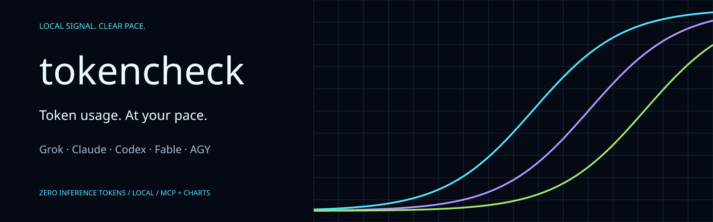
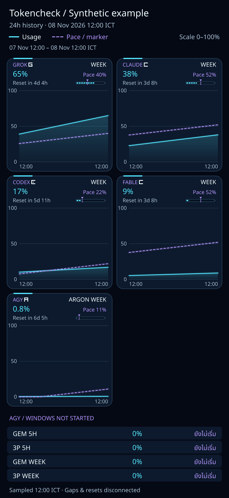

<p align="center">
  
</p>

# tokencheck

**Know your limits. Keep your rhythm.** A box-only usage and pace dashboard for Grok, Claude, Codex, Fable, and AGY—with compact MCP tools and glanceable charts. Monitoring consumes **zero inference tokens**.

<details>
<summary>See a synthetic usage chart</summary>

<p align="center">
  
</p>

Synthetic example generated by `docs/render_example.py`, using original neutral identifiers and the bundled OFL font. Values and timestamps are invented; no local account, usage history, or credentials were read. Fable is a model-scoped window reported by the Claude usage transport.

</details>

A local quota and pace monitor for Claude, Codex, Grok, and AGY. One daemon collects usage metadata every 60 seconds, recomputes pacing from its caches every five seconds, and serves a mobile dashboard, CLI, and five MCP tools. All providers are optional and **disabled by default**. Collection and presentation consume **zero inference tokens**: no model prompts, chat completions, or background agents are created.

The tool runs entirely on one box. Provider usage reads can use that box's existing CLI login or the dedicated Claude subscription login described below. There is no SSH collection, remote credential copy, or automatic login. The isolated Claude access token is renewed only by running the normal Claude CLI (`claude auth status`) against that isolated profile, as described below. No HTTP GET triggers collection.

## Requirements and layout

Use Linux, Python 3.11 or newer with `venv` and pip, and the provider CLIs you enable. On Debian/Ubuntu, install the distribution packages `python3`, `python3-venv`, and `python3-pip` if missing. Grok additionally needs tmux. Install provider CLIs manually through their normal distribution channels; this installer does not download or configure them. Subscription access and supported usage commands are external prerequisites.

The usage transports require compatible CLI commands: Codex `app-server` with `account/rateLimits/read` (optional `tokscale usage --json` fallback), Grok `dashboard` with the `/usage` → `show` menu, and AGY's non-inference `/usage` print command. Do not enable a provider whose CLI treats those commands as prompts. Recheck compatibility after CLI upgrades; the offline suite mocks these programs and does not verify the behavior of a user's installed version. Use a dedicated Grok dashboard pane without concurrent typing or other automation. The optional Claude login instructions below also use tmux; a separate terminal can be used instead.

The daemon, CLI, HTTP dashboard, history cache, and statusline capture use the Python standard library. MCP needs `mcp`; PNG export uses `resvg-py==0.5.0` with a bundled Thai/Latin Noto Sans Thai font (SIL OFL 1.1). Matplotlib remains a lazy fallback. `requirements.txt` pins the direct packages to the versions inspected in the existing environment. Transitive dependencies are resolved by pip; this is not a complete dependency lockfile.

Place the source in a directory such as `$HOME/.local/lib/pacer-tokencheck`. `providers/claude.py`, `codex.py`, `grok.py`, and `agy.py` contain the transports; `collectors.py` only orchestrates them and writes cache contracts. `core.py` owns pure quota/pacing calculations, `daemon.py` owns publication and base HTTP handling, and `pacer_daemon.py` owns the process lifecycle and outage watcher.

## Install

From the source directory:

```sh
./install.sh --dry-run
./install.sh
systemctl --user daemon-reload
systemctl --user enable --now pacer-tokencheck.service
python3 tokencheck.py --self-check
```

Edit `enabled_providers` in the created configuration only after completing the local setup for providers you want. With `[]`, readiness and the dashboard work without provider logins or outbound usage requests.

If user systemd is unavailable (for example in a container), run `./start-daemon.sh` and then `python3 tokencheck.py --self-check`, or keep `./venv/bin/python pacer_daemon.py` in a foreground terminal. The installer does not execute systemctl.

Installation creates or reuses `venv`, installs `requirements.txt`, creates a default configuration with no enabled providers if missing, and writes the user systemd unit. Claude statusline wrapping is optional: pass `--claude-statusline` to opt in. Existing settings and service units receive timestamped backups. The wrapper preserves the original display, stdin, stdout, stderr, optional settings fields, and exit status. Capture failures are silent. No credentials are copied and no provider login is performed. Installation prints the start command but does not start or restart the daemon.

Use `--claude-settings /path/to/settings.json` to select another statusline settings file. This flag also opts in to wrapping. `--claude-statusline` without a custom path targets `$HOME/.claude/settings.json`. Default installation does not read or modify Claude settings; review the dry-run first. An existing direct invocation of the former hook retains its display through `claude_statusline_legacy_display.py`. That file remains a compatibility dependency.

For an environment whose venv already has all three dependencies (MCP, resvg-py, Matplotlib), `./install.sh --offline` verifies them without downloading. `--dry-run --offline` prints the plan without installation or network activity. A dry-run does not prove pip or systemd works on a new machine.

`start-daemon.sh`, `stop-daemon.sh`, `ensure-daemon.cron.sh`, and `run-mcp.sh` remain compatible entrypoints. The cron script invokes the guarded starter; it remains available if a user service is unavailable. Avoid scheduling multiple independent service managers for the same installation. The daemon's persistent lock prevents two writers. The starter reports a nonzero status if readiness does not arrive.

Tailnet exposure is optional and requires the explicit installer flag `--tailscale-serve`. It configures a TCP forward to loopback; it does not authenticate Tailscale. Add the exact address or DNS hostname clients use to `allowed_hosts` before exposure. The daemon continues to bind only to loopback. A denied Host returns 421. There are no built-in personal hosts, tailnet addresses, or wildcard host suffixes.

## One configuration

The default file is `$HOME/.config/pacer-tokencheck/config.toml`. Set `PACER_CONFIG` to choose a TOML or `.json` file. An explicitly selected missing file is an error for runtime commands; installation can create it. Omitted default configuration uses the defaults below.

```toml
state_dir = "~/.local/share/pacer-tokencheck"
port = 48829
poll_interval = 60
oauth_interval = 600
# Omit to derive this from state_dir:
# claude_config_dir = "~/.local/share/pacer-tokencheck/claude-usage-config"
enabled_providers = [] # opt in, e.g. ["codex"] after local setup
grok_tmux_pane = "pacer-grokusage"
allowed_hosts = []
```

| Key | Meaning and validation |
| --- | --- |
| `state_dir` | Absolute or `~` path for caches, logs, locks, history, and PNG output. |
| `port` | Loopback HTTP port, integer 1–65535; default 48829. |
| `poll_interval` | Integer 60–86400 seconds; default 60. Slow polls schedule the next poll without a burst of catch-up requests. |
| `oauth_interval` | Integer 600–604800 seconds; default 600. Persistent cooldown and Retry-After can defer it further. |
| `edge_push_enabled` | Optional push of a compact snapshot to an edge dashboard after each poll (default `false`). |
| `edge_push_url` | HTTPS ingest URL, e.g. `https://<worker>.<subdomain>.workers.dev/ingest`. |
| `edge_push_secret_file` | File (mode 600) holding the ingest bearer secret; read at push time, never logged. |
| `claude_auto_refresh` | Renew the isolated Claude access token ahead of expiry through the normal CLI (default `true`). |
| `claude_config_dir` | Isolated profile; defaults to `<state_dir>/claude-usage-config`. The default interactive Claude directory is rejected. |
| `enabled_providers` | Unique subset of `grok`, `claude`, `codex`, `agy`; `[]` (the default) disables all collection. |
| `grok_tmux_pane` | Private tmux session/pane target, default `pacer-grokusage`; restricted to safe target characters. Use a dedicated dashboard, never an interactive agent pane. |
| `allowed_hosts` | Extra exact Host names/addresses without the HTTP port. Loopback names are always allowed. |

Unknown keys and invalid values fail validation. Configuration does not contain credentials. Defaults are based on the process HOME, never an embedded user directory.

Precedence is compatibility environment overrides `PACER_STATE_DIR` / `PACER_CLAUDE_CONFIG_DIR`, then file values, then defaults. If only state is overridden and the isolated path is omitted, the isolated path follows that state. CLI, daemon, MCP, starter, stop script, and statusline resolve this same configuration. The installer pins `PACER_CONFIG` and the effective state path in the hook command so capture and collection agree even when Claude starts outside the daemon's shell. Re-run installation after deliberately changing those paths. Legacy daemon `--state-dir` / `--port` flags remain process-specific compatibility options; use configuration for a complete installation.

Old `TOKENCHECK_*` URL/state/port variables and `PACER_TOKENCHECK_URL` are superseded by this configuration. Optional watcher environment variables remain: `PACER_UNHEALTHY_THRESHOLD_SECONDS`, `PACER_WEBHOOK_DEBOUNCE_SECONDS`, `PACER_TOKENCHECK_WEBHOOK_URL`, and `PACER_TOKENCHECK_WEBHOOK_HEADER`. Explicit legacy `PACER_ALLOWED_HOSTS` and `PACER_TAILNET_IP` also extend the Host allowlist. The starter no longer sources an arbitrary state `env` file; supply watcher variables in the service environment if needed.

Validate without reading credentials or contacting any service:

```sh
python3 tokencheck.py --validate-config
python3 config.py
```

`python3 tokencheck.py --self-check` validates configuration, reads only local `/healthz` and `/v1/collector`, and prints readiness plus provider states. Exit 0 means ready, 1 means the daemon is not ready/reachable, and 64 means invalid configuration. A ready daemon may have unavailable providers; provider status is reported separately. This check never polls providers or invokes a model.

## Provider setup and observation rules

**Claude.** Passive statusline capture stores only allowlisted usage windows and observation metadata in `<state>/claude-statusline.json`. Missing, null, invalid, delayed, or out-of-order windows cannot overwrite newer valid observations. Each window retains its own `measured_at`, `source`, and computed `age_seconds`.

Subscription OAuth usage supplies model-scoped windows and fallback data. It reads only the dedicated isolated profile's `.credentials.json`, only when the persistent gate is due. The usage HTTP transport disables inherited proxies and rejects redirects, so the bearer credential is sent only to the fixed usage endpoint. The default interactive login, `CLAUDE_CONFIG_DIR`, API-key variables, and inherited setup-token/environment OAuth values are never credential fallbacks. Symlinked credential files pointing out of the isolated profile are rejected.

To log in manually, start `tmux new-session -s claude-usage-login`. Inside that pane, enter the source directory and set `PACER_CONFIG` if using a custom file, then resolve the effective profile and run the normal isolated flow:

```sh
ISOLATED_CLAUDE_DIR="$(python3 config.py --field claude_config_dir)"
mkdir -p "$ISOLATED_CLAUDE_DIR"
chmod 700 "$ISOLATED_CLAUDE_DIR"
env -u CLAUDE_CODE_OAUTH_TOKEN -u ANTHROPIC_API_KEY -u ANTHROPIC_AUTH_TOKEN -u CLAUDE_CODE_SETUP_TOKEN CLAUDE_CONFIG_DIR="$ISOLATED_CLAUDE_DIR" claude auth login --claudeai
```

Use the **claude.ai subscription** login. Do not use setup-token. Never paste tokens into commands or logs. Insufficient-scope credentials, or an expired refresh grant, require re-login through this normal isolated flow; the monitor never falls back to another login.

**Edge dashboard (optional).** With `edge_push_enabled = true`, `edge_push.py` posts a compact JSON snapshot after each poll: percentages, pace, reset times, observation ages and a 24 h history in 10-minute buckets. It contains no tokens, emails, account IDs or paths. Pushes run on a background thread with a 10 s timeout, at most once per 60-second poll (at least 55 s apart), and back off up to 15 minutes on failure. Status (`last_ok_at`, `last_error`, `consecutive_failures`, …) appears under `edge_push` in `/v1/collector`. The receiving Cloudflare Worker lives in `edge/` (see `edge/README.md`). It stores the latest snapshot in one SQLite-backed Durable Object, which fits the free plan; KV's 1,000 writes per day does not cover per-minute pushes. It serves one unlisted, self-contained page at `/<read key>/`.

**Access-token renewal.** Claude access tokens last about eight hours. With `claude_auto_refresh = true` (the default) the collector reads only `expiresAt` from the isolated `.credentials.json` on each poll. Within 60 minutes of expiry, or after it, it runs `claude auth status` with `CLAUDE_CONFIG_DIR` set to the isolated profile and a minimal allowlisted environment: no inherited `CLAUDE_CONFIG_DIR`, API keys, setup-tokens or environment OAuth tokens. There is no shell, a 60-second timeout and discarded output. The CLI performs its own normal refresh and rewrites the profile; no inference is used. Attempts are at least 600 seconds apart. If the CLI judges the token still fresh, the next try lands inside its own near-expiry window; failures back off 10, 20, 40 and then 60 minutes. Non-secret results (`last_result`, `last_ok_at`, `access_token_expires_at`, `next_refresh_at`, failures) are kept in `<state>/claude-token-refresh.json` and shown under `providers.claude.token_refresh` in `/v1/collector`. Renewal never touches the OAuth usage cache, lock, `next_due` or backoff; a renewed token is used when the gate is next due. `python3 claude_token_refresh.py` prints the plan without running anything, and `--run` renews now if due.

All Claude OAuth activity shares the exact persistent files `<state>/claude-oauth-cache.json` and `<state>/claude-oauth.lock`. The lock spans credential selection and the entire request. Reservation is persisted before transport selection. The next attempt is at least 600 seconds after completion by default, and Retry-After/backoff survives restarts, failures, and crashes. Existing `next_due`, errors, backoff, and historical normalized windows remain authoritative. **Never reset or replace this cache or lock to force a request.** No migration runs at startup.

Newest valid observation wins per window; passive capture wins an exact timestamp tie. A FABLE WEEK window requires genuine scoped OAuth parser provenance. The monitor neither invents a 5H window from null data nor relabels another weekly model as Fable. Historical OAuth windows may retain original provenance and age; retired passive sources are excluded.

**Codex.** Log in manually with the normal local Codex CLI flow. Collection first uses `codex app-server` JSON-RPC `account/rateLimits/read`, then an already installed `tokscale usage --json`, then local Codex rollout logs through `check_usage.py`. It never sends an inference request. Old rollout observations keep their actual timestamps and can be rejected as too old. `check_usage.py --json` remains a standalone local usage reader.

**Grok.** Complete the local Grok CLI's normal login manually. Collection opens or uses the dedicated tmux dashboard and its `/usage` modal. It checks dashboard visibility, empty input, slash-command completion, and the usage submenu before pressing Enter; it aborts if those safety gates fail. It never creates an agent. `grok_tmux_pane` selects the dedicated target. The unused management-billing and admin-key paths have been removed.

**AGY.** Complete the local AGY CLI's normal authentication manually. Collection runs the existing local `agy -p /usage --output-format json --print-timeout 35s` usage panel. Known Gemini/third-party buckets retain their mapping, disabled weekly-exhausted buckets retain their semantics, and recognized extra weekly/5H buckets such as Argon render generically. Unknown extra buckets remain informational. An unused AGY window that floats with now is shown as not started, with null pace, rather than a fabricated pace value.

Disabled providers do not launch a subprocess, inspect a login, or consume an OAuth attempt. They are marked disabled in collector status and omitted from the combined computed view. Explicit single-provider views retain the existing unavailable result shape when that provider is disabled. Failures are isolated per provider; other providers keep polling. Last-good values keep their real observation clocks and become stale instead of being relabeled as fresh.

## CLI, HTTP, and MCP contracts

```sh
python3 tokencheck.py --json
python3 tokencheck.py --provider codex --chart
```

Quota verdict exit codes remain 0 proceed, 1 caution/degraded, 2 critical, and 3 unknown/unavailable. A missing/frozen service can fall back to the last snapshot with degraded trust. The CLI does not start collectors. `--stdin` supports deterministic offline analysis.

| Route | Response |
| --- | --- |
| `/`, `/dashboard` | Mobile/desktop HTML with the current published view embedded safely. |
| `/health`, `/healthz` | Daemon readiness, sequence, and tick age; non-ready returns 503. |
| `/v1/snapshot` | Full JSON envelope with raw input, computed results, sources, sequences, and exit codes. |
| `/v1/limits` | Compatible raw limits view. |
| `/v1/tokencheck?provider=all` | Computed `result` wrapper; provider may be all/claude/codex/grok/agy. |
| `/v1/collector` | Per-provider winner, attempts, states, generation, and zero-token/box-only metadata. |
| `/v1/unhealthy` | Persistent outage watcher state. Disabled providers do not open incidents. |
| `/v1/history?hours=168&step=1800` | Downsampled history; hours 24/72/168; optional integer step 60–86400 seconds. |

History defaults to seven days. Default steps are 300 seconds for 24h, 900 for 72h, and 1800 for 168h. The JSON shape remains:

```json
{"hours":168,"step":1800,"generated_at":"UTC ISO timestamp","history_hours":48.0,"series":[{"provider":"codex","window":"WEEK","points":[{"t":"UTC ISO timestamp","used":12.3,"pace":15.0}]}]}
```

GET and HEAD are read-only. The dashboard/history routes negotiate gzip, include `Vary: Accept-Encoding`, use representation-specific ETags and private revalidation, and return bodyless 304 responses. HEAD reports the selected representation's length. Other JSON routes retain their existing no-store behavior. Host, request body, query, and admission guards remain in force.

Register the stdio MCP entrypoint using the absolute source directory on the target machine. For clients accepting an `mcpServers` JSON configuration:

```json
{"mcpServers":{"tokencheck":{"command":"/absolute/source/directory/run-mcp.sh","env":{"PACER_CONFIG":"/absolute/config/directory/config.toml"}}}}
```

The five tool names and parameters remain:

| Tool | Purpose |
| --- | --- |
| `tokencheck_minimal(provider="all")` | Six-column TSV followed by a JSON row object; preferred for coding/data mapping. |
| `tokencheck_chart(provider="all", width=48)` | Ready-to-use pace chart text. |
| `tokencheck_png(provider="all", hours=24.0)` | Usage/pace PNGs under `<state>/png` plus `<state>/tokencheck-usage-pace.png`; returns absolute paths. |
| `tokencheck_snapshot(provider="all", full=False)` | Computed view JSON, or full snapshot envelope. |
| `tokencheck_methods()` | Collector methods, daemon health, and outage state. |

Minimal output retains this format, with literal tab characters between fields:

```text
tokencheck_minimal\tchecked_at_ict=<ISO+07:00>\tseq=<n>
provider\tplan\twindow\tused_pct\tpace_pct\treset_in
<one row per provider/window, six columns>

json\t{"checked_at":"...","checked_at_ict":"...","seq":1,"rows":[{"provider":"codex","plan":"...","window":"WEEK","used_pct":12.3,"pace_pct":15.0,"reset_in":"3d 8h","resets_at":"...","resets_at_ict":"...","window_hours":168}]}
```

No assessment/status fields are inserted into TSV rows. A not-started pace uses `-` in TSV and null in JSON. Preserve JSON field names and numeric precision when consuming output. Use connector name `tokencheck`. The compact five-tool catalog exposes only name, description, and inputSchema; results remain text-only. Temporary lifecycle/file diagnostics have been removed; neither the wrapper nor MCP server writes diagnostic logs. Client catalog caching is client-specific and routine removal/re-addition is not required. `run-mcp.sh` uses the installed venv and the existing guarded daemon starter; it is a runtime entrypoint, not an offline test command. The wrapper requires `/bin/bash` and resolves its own directory using Bash builtins, independent of PATH and CDPATH. It redirects starter output to stderr and continues to the MCP server if the starter returns failure. A starter that has not returned still delays MCP initialization. For diagnosing stdio startup separately from autostart, invoke `/absolute/source/directory/venv/bin/python /absolute/source/directory/mcp_server.py` directly; this form does not start the daemon. The Python exec argv alone cannot distinguish this direct invocation from the wrapper, which execs the same command.

## Dashboard and performance

Cards render immediately from the daemon's immutable current view, before awaiting any history response. History loads asynchronously and failures do not suppress current values. Seven days remains the default selection. Provider order remains Grok, Claude, Codex, AGY; mobile card styles, windows, plan/reset displays, and source ages are retained. No external scripts, fonts, or image assets are required.

The process keeps a bounded, locked history cache: at most four state paths, 11,000 samples per path, and 16 downsample variants. Cold reads cap input at 32 MiB; append reads start at the saved offset and retain partial JSONL records until complete. A tail anchor catches truncate-and-regrow changes, while inode/size/mtime/ctime changes detect rotation, truncation, and rewrites. Unchanged history is not reopened or reparsed. Cached `generated_at` is the generation time of that history result; it does not claim a fresh provider observation. A stopped history file does not advance the cached downsample window until it changes. Raw history remains on disk with its existing seven-day retention policy.

Downsampling selects the newest numeric point per bucket before formatting its timestamp, avoiding timestamp formatting for discarded points. MCP loads plotting dependencies only when `tokencheck_png` is called, so text tools avoid rasterizer startup work. Successful resvg rendering never imports Matplotlib.

Client performance marks are `pacer-script-start`, `pacer-view-rendered`, `pacer-initial-render-complete`, and `pacer-history-rendered`. These are application milestones, **not FCP measurements**. For an actual browser measurement, use DevTools Performance or `performance.getEntriesByType('paint')` after navigation and inspect `first-contentful-paint`; compare cold and warm runs on the same device/network. No FCP result is claimed by this refactor. The offline tests exercise handlers without a socket and cannot establish browser paint time or real deployed HTTP latency.

## Troubleshooting and verification

Start with `--validate-config` and `--self-check`, then inspect `<state>/collector.log`, `daemon.stderr`, and per-provider safe attempt reason codes. A PID alone does not prove readiness. Use the configured state path everywhere. If readiness fails, check the service journal, port conflicts, and lock owner before starting another daemon.

For a stale Claude window, inspect its normalized `source`, `measured_at`, and `age_seconds`, and the safe OAuth cache schedule fields. A missing passive render and an OAuth cooldown are independent conditions. Do not inspect or print credential files, force a probe, reset cooldowns, or introduce another credential fallback. Use only the normal isolated login flow when renewal is required.

For an unavailable Grok provider, inspect the dedicated tmux dashboard and safe reason code; do not send a prompt or press Enter outside the usage safety flow. For Codex/AGY, verify the corresponding CLI is installed and logged in locally. Disable an unneeded provider through configuration instead of deleting another provider's cache.

If a phone cannot reach the dashboard, verify local readiness and the separately configured tailnet forward/allowed Host. Network exposure is optional. This refactor does not diagnose or repair a tailnet timeout.

The outage watcher and cron starter remain available. The watcher persists per-provider health and debounces optional configured webhook notifications after a sustained outage. Merely enabling the tool does not configure a notification endpoint. An explicitly configured webhook sends the local hostname, provider health, and safe collector attempt summaries to that endpoint; leave it unset for no outbound notifications. Webhook requests disable inherited proxies and reject redirects, including redirects that could forward a configured authorization header. Use the final HTTPS endpoint when configuring an authenticated webhook.

Offline checks:

```sh
./test-offline.sh
```

The runner uses the installed venv with a new temporary HOME/config/state, `enabled_providers=[]`, no inherited environment values, and no bytecode writes in the source. Provider-specific tests opt in only with mocked transports. Tests mock credential readers, usage transports, provider subprocesses, and HTTP clients, and use temporary config/state/settings. They include three collector polls with subprocess SSH blocked, retained clocks across failure/restart, OAuth budget/backoff/concurrency, statusline transparency, provider optionality, history caching, in-memory HTTP semantics, and a Node VM client test with a never-resolving history fetch. The VM is not a browser and does not measure paint. Run the offline commands above to verify this checkout.


## Offline PNG rendering

`plot_png.render_png` and the PNG CLI default to a 24-hour lookback. MCP keeps its existing tool arguments and paths, renders once, then atomically copies identical bytes to the stable alias. The CLI reads history without seeding or appending a snapshot. Nonpositive hours selects all history.

Charts fit one fixed **1179×2556 PNG** (393×852 logical pixels at 3×). Populated current windows use a compact two-column grid (one column for a single chart), with large usage percentages, reset countdowns, sparklines, and segmented batteries with violet triangle/line pace markers. Cyan usage and violet dashed recorded pace share a fixed 0–100% quota scale, including near-zero AGY values. The selected latest sample defines membership: absent windows or windows without finite real usage are hidden; zero is valid. Claude 5H additionally requires a real timezone-aware reset. Historical data cannot resurrect an absent Claude 5H window, and no 5H data is inferred. Current AGY windows with `started=false` and real usage appear in small rows with their actual percentage and Thai not-started state, without pace or reset claims. Active/current windows retain their selected history (24h by default).

All timestamps are ICT; reset countdowns are computed from recorded reset timestamps relative to render time. Missing/nonfinite values, missing windows, gaps over three minutes, quota decreases, start-state transitions, and reset changes over one minute break lines. Values outside 0–100 are clipped geometrically to the quota scale; numeric callouts retain their values. Invalid, naive, future, and out-of-range timestamps are excluded, with an explicit empty state when nothing populated remains.

Titles and window labels wrap at whitespace first, with Thai-safe cluster fallback only for overlong tokens. Optional titles have a compact header budget. Row heights adapt to wrapped labels while retaining readable type; if an unusually large set of current windows or an excessive title/label cannot fit the fixed canvas, rendering raises a clear error and preserves the previous PNG instead of silently dropping windows, clipping content, or making the text unreadably small.

The bundled `fonts/NotoSansThai.ttf` supports Thai and Latin and is explicitly loaded with system fonts disabled. `fonts/OFL.txt` contains its embedded copyright/license; `fonts/metrics.json` supplies conservative wrapping advances derived from the unmodified font. Dynamic text is XML-escaped. The renderer only accepts its passive SVG primitives and internal gradient reference, with no external resources, browser, or runtime font downloads.

If resvg is missing or raises a supported rendering error, a warning identifies the lazy Matplotlib fallback. It renders the same SVG layout and data using the bundled font; gradients become translucent flat fills and Thai shaping may differ. A missing bundled font, unsafe SVG, failed fallback, invalid PNG result, or file error fails explicitly and preserves the previous output. Matplotlib is retained in requirements for this fallback. PNG work never changes collection, gate decisions, raw JSON, or TSV.

## License and sharing

Original project code and the neutral provider identifier drawings are MIT-licensed; see `LICENSE`. Bundled Noto Sans Thai and its derived metrics remain under SIL OFL 1.1 with `fonts/OFL.txt`. These are separate licenses, not a blanket MIT claim. See `THIRD_PARTY_NOTICES.md` and `assets/logos/PROVENANCE.md`. No official provider logo artwork is distributed.

Share source files and bundled assets only. Exclude `.git`, virtual environments, config files, credentials, state/cache/history/snapshot files, logs, backups, and agent metadata. `.gitignore` protects routine additions but is not an export filter: inspect the final archive. Local Git history may contain personal author/committer metadata. Install dependencies on the recipient machine; do not copy an authenticated installation or venv.

## Copyright

Copyright (c) 2026 Worakan Jeeprabnan (kem). Project code and original artwork are MIT-licensed; see `LICENSE` and `THIRD_PARTY_NOTICES.md` for the separate font and dependency terms.
